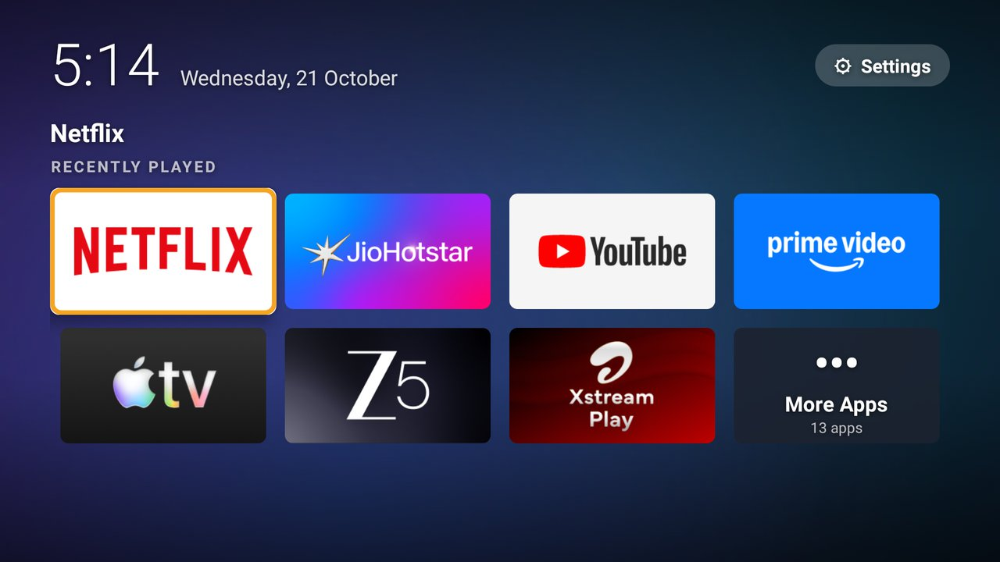

<p align="center"></p>

# Hush: a calm, ad-free home screen for older Android TVs

> The TV stops shouting ads at you, and stops tracking what you watch.

**Hush** replaces the cluttered, ad-filled Android TV home screen with a quiet one: your **7 most recently played apps**, a **More Apps** tile for everything else, a clock, and a slowly drifting aurora background.

It's built for older TVs with weak hardware. It was made for, and tested on, a 2018 **Sony Bravia KD-49X7500E** (Android TV 9, 32-bit chip, 2 GB RAM).



| | Hush | Stock Google launcher (same TV) |
|---|---|---|
| App size | **~70 KB** | tens of MB |
| Memory | **~23–40 MB** | ~100–200 MB |
| Focus animation, frames over 16 ms | **0.6–1.9%** (median 8 ms) | 91% (median 20 ms) |
| Ads, sponsored rows, tracking | **None. No internet permission at all** | Yes |

## Features
- **Recently played**: your 7 latest apps, 4 per row, newest top-left. Uses Android's usage stats (if you allow Usage access), so apps opened from remote buttons like Netflix count too.
- **More Apps**: everything else, A–Z.
- **Aurora background**: soft colour blobs that drift slowly and change with the time of day. It's drawn at 160×90 and upscaled, so it costs ~10% of one CPU core, and **0% when anything else is on screen**. You can turn it off (long-press ⚙ Settings).
- **⚙ Settings** button, always one press away.
- **Hide apps** you never use (long-press OK → *Hide from home*).
- **Your stock launcher stays installed and enabled.** Hush never disables anything, so undoing it is always one step.

## How it becomes "Home"
On many Android TVs the stock launcher always wins the Home button, even after you install another launcher. Hush ships a tiny accessibility helper that **catches the Home button** and opens Hush instead. It ignores every other button, stores nothing, and can't read anything on screen.
- **Press Home twice quickly** to get the stock home screen (the redirect stands aside for 10 minutes).
- If Hush ever keeps closing, the helper backs off on its own and leaves the stock home screen in place.

## Install (about 20 minutes)
**📖 Step-by-step guide with pictures:** [docs/index.html](docs/index.html) (also published at https://aniketrai.github.io/hush-tv-launcher/ once GitHub Pages is on).

Quick version for people who already use ADB:
```bash
# On the TV: Settings > Device Preferences > About > press OK on "Build" 7 times,
# then Developer options > ADB debugging (or USB debugging) > On.
scripts/enable-as-home.sh <tv-ip> hush.apk     # installs + turns on the Home redirect
scripts/disable-home.sh  <tv-ip> --uninstall   # undo everything
```
Get `hush.apk` from [Releases](../../releases), or build it yourself (below).

## Build from source
Plain Java against the Android 9 framework: no Gradle, no libraries.
```bash
# Needs JDK 17 and the Android SDK command-line tools
sdkmanager "platforms;android-28" "build-tools;34.0.0"
./build.sh            # -> build/hush.apk
```
The first build creates a private signing key in `keystore/`. **Never commit it** (it's in `.gitignore`), and back it up, because updates must be signed with the same key.

## Compatibility
- **Tested:** Sony KD-49X7500E, Android TV 9.
- **Should work:** Android TV 7–12 devices with a standard Home key. Not yet tested on Google TV (Chromecast with Google TV, newer Sony/TCL). Please open an issue with your model and what happened.
- The remote's Home button needs to send a normal `KEYCODE_HOME`, which almost all do.

## Safety notes
- Hush never disables or uninstalls your stock launcher. Please don't do that yourself unless you have a tested way back into Settings without it.
- Turn **ADB debugging off** again when you're done (the install script offers to do it).
- Never open factory or engineering menus.

## Security & privacy
- **No internet permission**: Android blocks Hush from sending or receiving anything. No ads, analytics or tracking, by design.
- **No storage access, no backups, no third-party libraries.**
- Its only permission is *Usage access* (optional, for "Recently played"). The accessibility helper acts only on the Home key, can't read the screen, and runs in its own isolated process.
- **Verify your download:** only install `hush.apk` from [Releases](../../releases) and check its SHA-256 against the Release notes. Official builds are signed with certificate SHA-256 `52:90:b7:e7:…:6c:eb:5b:fe` (full value in [SECURITY.md](SECURITY.md)).

Full details, threat model and how to report a vulnerability privately: **[SECURITY.md](SECURITY.md)**.

## Credits
Built by [Aniket Rai](https://github.com/aniketrai) with [Claude Code](https://claude.com/claude-code), as part of an audit-first, reversible tune-up of a 2018 TV.
App logos in screenshots belong to their respective owners.

## Licence
[MIT](LICENSE)
